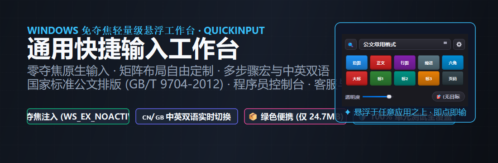
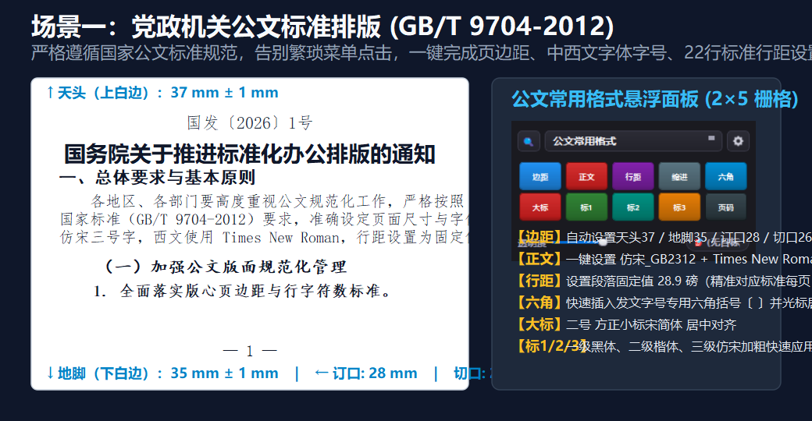
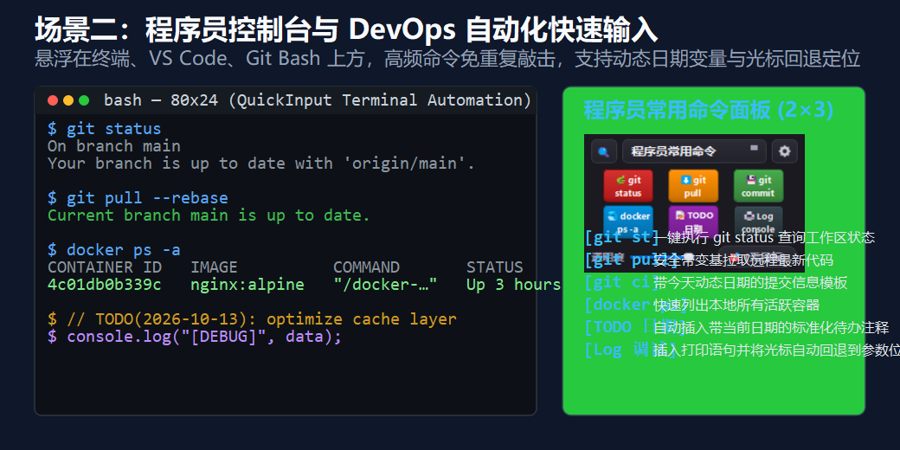
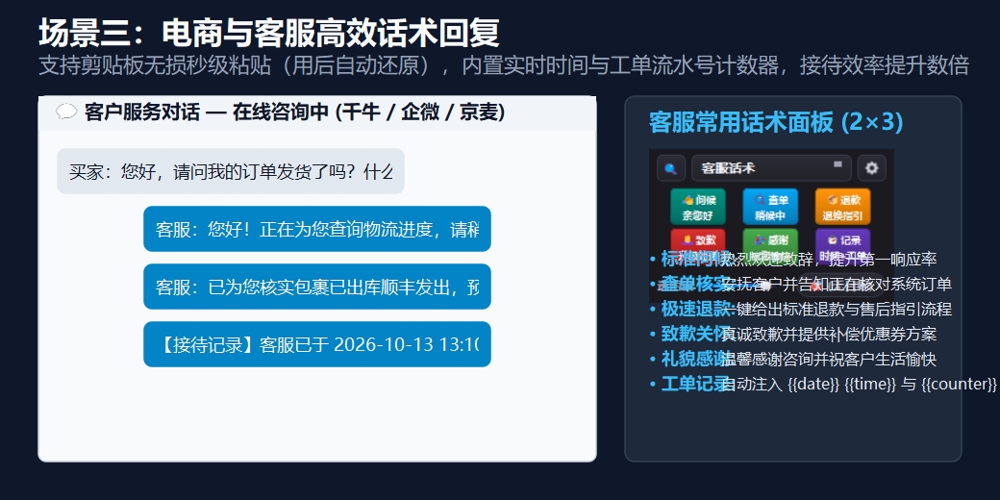
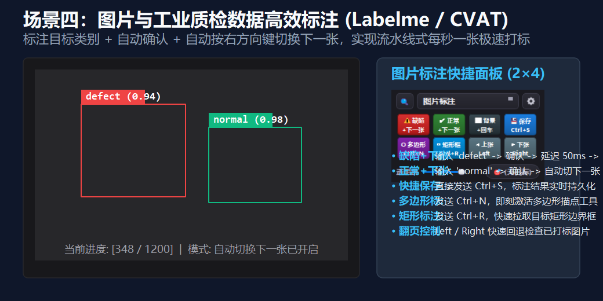
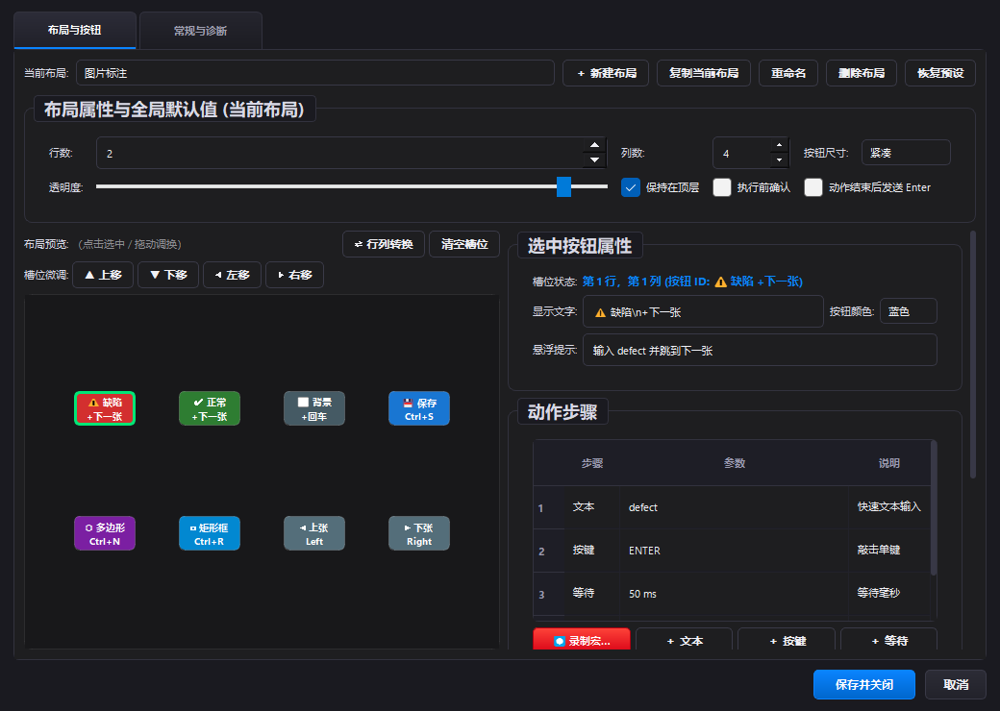
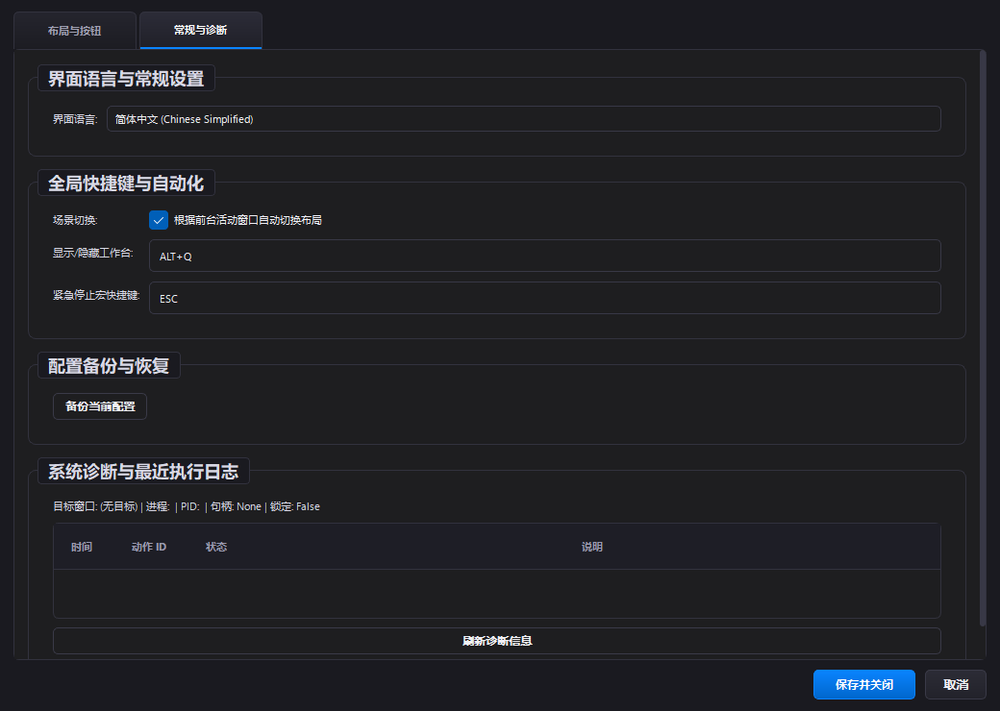
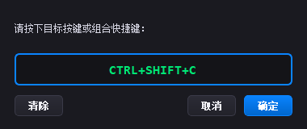

# QuickInput - Lightweight Floating Action Panel & Automation Workbench

[English](README_EN.md) | [简体中文](README.md)

[](https://www.microsoft.com/windows)
[](https://www.python.org/)
[](https://riverbankcomputing.com/software/pyqt/)
[-F58220.svg)]()
[]()
[]()
[](LICENSE)

<p align="center">
  
</p>

**QuickInput** is a lightweight, zero-focus-stealing floating action panel and quick input workbench tailored for Windows.

Without touching code or complex JSON files, QuickInput floats unobtrusively above any target application (such as **Word / WPS, Terminal / VS Code, Customer Support chat clients, Data Annotation tools, web browsers, and enterprise software**). With a single click, users can perform **Unicode text injection, individual keystrokes, shortcut combinations, lossless clipboard templates, and multi-step macro sequences** while effortlessly switching between purpose-built keyboard layouts.

---

## 🌟 Core Features & Design Philosophy

1. **Zero Focus Stealing (`WS_EX_NOACTIVATE`) & Native Windows Mechanics**:
   - Engineered with native Win32 `WS_EX_NOACTIVATE` and `MA_NOACTIVATE` architectures.
   - Clicking floating buttons never steals focus or deactivates target applications. **Your text caret stays firmly in place, allowing seamless typing with physical keyboards without interruption**.
   - Preserves Windows native window titlebars and edge-resizing. Closing (`×`) minimizes to the system tray, unhooking all hotkeys upon exit without lingering background processes.
2. **Direct Unicode `SendInput` Engine**:
   - Built on standard Windows `SendInput` API with `KEYEVENTF_UNICODE` flags.
   - **Completely bypasses active IME candidate windows**, preventing dropped characters, unexpected candidate selections, or text truncation.
3. **National Standard Compliance & Ready-to-Use Scenarios**:
   - Built-in layout strictly compliant with **Party & Government Official Document Format (GB/T 9704-2012)**.
   - Ready-to-use preset packs for **Developer & DevOps Console, E-Commerce Customer Service, and Image/Data Annotation**.
4. **Visual Layout Studio & Safe Key Capture**:
   - Interactive grid editor with click-to-select slots, drag-and-drop ordering, **Row/Column Transposition (Transpose)**, and slot fine-tuning.
   - Dedicated key capture dialog captures keys and shortcuts directly. Pressing `Enter` records the key itself rather than prematurely submitting or closing the dialog.
5. **Dynamic Template Variables & Safe Clipboard**:
   - Insert live parameters: `{{date}}` (current date), `{{time}}` (current time), `{{counter}}` (incrementing sequence ID), `{{clipboard}}` (clipboard text), `{{app_name}}` (foreground app name).
   - High-speed clipboard pasting **automatically restores the user's original clipboard content**, preserving your routine workflow.
6. **Bilingual Internationalization (i18n)**:
   - Built-in support for **Simplified Chinese** and **English**. Dynamically refreshes all tabs, layout names, context menus, diagnostics, and dialogs in real time without restart.
7. **Ultra-Lightweight Portable Distribution**:
   - Built with a clean environment without redundant binary packages: uncompressed directory is only **61.9 MB**, compressed portable ZIP is only **24.7 MB**.

---

## 🎬 Real-World Application Scenarios

### Scenario 1: National Standard Official Document Typesetting (GB/T 9704-2012)

Drafting and formatting official documents in Word / WPS requires strict adherence to national standards (margins in millimeters, exact font hierarchy, 22-line paragraph spacing). Instead of searching through nested menus, QuickInput configures everything with single clicks.

<p align="center">
  
</p>

| Button | Standard Clause | Requirement | Automated Action |
| :--- | :--- | :--- | :--- |
| **【边距】 Margins** | Clause 5.2.2 | **Top 37mm, Bottom 35mm, Left 28mm, Right 26mm** | Opens Page Setup and inputs exact 37/35/28/26 mm margins |
| **【正文】 Body** | Clause 7.3.3 | **FangSong_GB2312 + Times New Roman 16pt (3号)**, Justified | Configures dual Asian/Latin fonts and sizes with `Ctrl+J` justification |
| **【行距】 Spacing** | Clause 5.2.3 | **22 lines per page, 28 characters per line** | Opens Paragraph settings and sets exact line spacing to **28.9 pt** |
| **【缩进】 Indent** | Clause 7.3.3 | **2 character first-line indent** | Automatically sets paragraph first line indent to 2 characters |
| **【六角】 Bracket** | Clause 7.2.5 | Document year enclosed in hexagonal brackets **“〔 〕”** | Inserts `〔 〕` and **positions caret in the center** for typing the year |
| **【大标】 Title** | Clause 7.3.1 | **XiaoBiaoSong 22pt (2号)**, Centered, Regular | Sets title font and size, triggering `Ctrl+E` centering |
| **【标1】 Heading 1** | Clause 7.3.2 | Heading 1 (e.g. "一、"): **SimHei 16pt (3号)** | Sets HeiTi 16pt with justified alignment |
| **【标2】 Heading 2** | Clause 7.3.2 | Heading 2 (e.g. "（一）"): **KaiTi 16pt (3号)** | Sets KaiTi 16pt with justified alignment |
| **【标3】 Heading 3** | Clause 7.3.2 | Heading 3 (e.g. "1."): **FangSong Bold 16pt (3号)** | Sets FangSong 16pt and applies bold styling (`Ctrl+B`) |
| **【页码】 Page No** | Clause 7.5 | 14pt Arabic numerals flanked by em-dashes | Inserts standard official page number template: `— 1 —` |

---

### Scenario 2: Developer Console & DevOps Automation

Developers frequently repeat shell commands across VS Code, Windows Terminal, and Git Bash. QuickInput floats near your terminal, dispatching repetitive commands and dynamic templates instantly.

<p align="center">
  
</p>

- **`git st`**: Sends `git status` with Enter to immediately inspect working tree changes.
- **`git pull`**: Dispatches safe rebase synchronization: `git pull --rebase`.
- **`git ci`**: Inserts a commit template with today's live date: `git commit -m "fix: update {{date}}"`.
- **`docker ps`**: Rapidly inspects all local container states: `docker ps -a`.
- **`TODO Date`**: Injects a standardized comment with current date: `// TODO({{date}}): `.
- **`Log Debug`**: Injects `console.log("[DEBUG]", );` and **automatically steps the cursor back 2 positions** for immediate parameter input.

---

### Scenario 3: E-Commerce Customer Service Quick Replies

Handling customer inquiries across chat platforms (AliWangwang, Jingdong, WeChat Work) requires speed and precision. QuickInput delivers instant replies without needing external notepad lookups.

<p align="center">
  
</p>

- **Standard Greetings**: Warm, professional greetings to boost initial response rate metrics.
- **Order Tracking**: Assures buyers that order and logistics verification is in progress.
- **Lossless Fast Paste**: High-speed paste injection that **automatically restores original clipboard contents**.
- **Ticketing Records**: Automatically inserts reception memos containing system timestamps and incrementing ticket IDs:
  > `【接待记录】客服已于 {{date}} {{time}} 接待咨询，工单编号: CS-{{counter}}。`

---

### Scenario 4: Image & Industrial Quality Inspection Annotation

In computer vision dataset preparation (Labelme, CVAT, LabelImg) or defect classification, traditional steps ("draw box -> type label -> press enter -> click next") are repetitive and slow.

<p align="center">
  
</p>

- **Defect + Next**: Types label `defect` -> confirms Enter -> waits 50ms -> sends `Right` arrow key to flip to the next image for **rapid pipeline annotation**.
- **Normal + Next**: Types `normal` -> confirms Enter -> flips to next image.
- **Tool Shortcuts**: Seamlessly triggers rectangle tool (`Ctrl+R`), polygon tool (`Ctrl+N`), and file saving (`Ctrl+S`).

---

## 🛠️ Settings Studio & Visual Macro Builder

Click the gear icon on the floating panel to open the comprehensive Settings Studio:

<p align="center">
  
  
</p>

### 1. Layouts & Buttons Studio
- **Interactive WYSIWYG Grid**: Click any slot to select, swap positions, clear, or fine-tune positioning.
- **Row/Column Transposition (Transpose)**: One click to swap matrix dimensions (e.g. 2×4 to 4×2) with adaptive button rearrangement.
- **Multi-Step Action Pipelines**: Combine **Text Input**, **Keystrokes**, **Shortcut Combinations**, and **Delays** into unified macro buttons.
- **Protected Key Capture Dialog**:
  <p align="center">
    
  </p>
  Press any key (e.g. `F5`, `Tab`, `Enter`) or combination (`Ctrl+Alt+S`) to record. Pressing `Enter` records the key itself rather than prematurely closing the dialog!

### 2. Window Sensing, App Binding & Diagnostics
- **Target Sensing**: Live detection of foreground window title, process name, PID, and handle.
- **Auto-Switching Profiles**: Bind layouts to target applications (e.g., auto-switch to Annotation layout when `labelme.exe` is focused).
- **Target Lock Mode**: Lock input targets via tray icon or main window lock button to guarantee safe injection even if focus temporarily wanders.
- **Execution Diagnostics**: Real-time event log tracking timestamp, status, and descriptive details for every macro step.

---

## ⌨️ Global Hotkeys

| Hotkey | Description | Mechanism |
| :--- | :--- | :--- |
| **`Alt + Q`** | Show / Hide Workbench globally | Qt QueuedConnection cross-thread signal bridge (zero UI freeze) |
| **`Esc`** | Emergency Stop active macro | Immediate circuit-breaker halt for any multi-step macro |

---

## 🚀 Getting Started

### Option 1: Standalone Portable Release (Recommended)
1. Download from Releases or locate inside:
   👉 [`dist/QuickInput/QuickInput.exe`](dist/QuickInput/QuickInput.exe)
2. Double-click to run immediately without installation, admin rights, or registry entries.
3. *(Optional: launch `QuickInput_Debug.bat` to run with full console logging).*

### Option 2: Run from Source
```bash
# 1. Clone the repository
git clone https://github.com/Gavin-Liuu/QuickInput.git
cd QuickInput

# 2. Install dependencies
pip install -r requirements.txt

# 3. Launch application
python main.py
```

### Option 3: Build Standalone Portable Executable
QuickInput includes an automated build pipeline that excludes unnecessary heavy Qt libraries:
```bash
python build_portable.py
```
Output artifacts in `dist/`:
- Portable Folder: `dist/QuickInput/` (~61.9 MB)
- Portable ZIP Archive: `dist/QuickInput_v1.0.0_Windows_x64.zip` (~24.7 MB)

---

## 🏗️ Software Architecture

QuickInput adopts a decoupled layered architecture ensuring clean separation between business domain and platform specifics:

```text
FloatPoint/
├── domain/                  # Pure domain models (Action, ActionStep, Button, Layout, Profile, i18n)
├── application/             # Application services (ActionExecutor, TargetManager, MacroRecorder, LayoutManager, AppContext)
├── platform_layer/          # Platform abstraction & OS adapters
│   ├── base.py              # Cross-platform abstract interfaces
│   └── windows/             # Win32 SendInput engine, window handles, clipboard, global hotkeys
├── storage/                 # Config persistence & package management (.qipack / JSON)
│   ├── config_store.py      # Atomic writes, schema version migration, corrupt-recovery
│   └── pack_store.py        # Import/export, path traversal sanitization, zip compression
├── ui/                      # PyQt5 floating widgets & visual studio
│   ├── floating_panel.py    # Zero-focus-stealing floating workbench
│   ├── settings_dialog.py   # Visual layout editor, diagnostics & app binding
│   ├── key_capture_dialog.py# Keyboard & shortcut capture modal
│   ├── new_layout_dialog.py # New layout wizard
│   └── tray_icon.py         # System tray icon & context menu
├── packs/                   # Built-in out-of-the-box scenario packs
│   ├── official_doc/        # Party & Government Official Document Format (GB/T 9704-2012)
│   ├── programmer/          # Developer commands & terminal workflow
│   ├── customer_service/    # Customer support response scripts
│   └── annotation/          # Image labeling & quality control
├── docs/images/             # High-resolution screenshots and scenario graphics
├── tests/                   # 100 comprehensive unit & regression test cases
└── build_portable.py        # Lightweight PyInstaller portable packaging script
```

---

## 🧪 Automated Testing

All features and regression fixes are verified by an automated test suite:

```bash
python -m pytest tests/
```

- ✅ **100/100 tests passing**.
- ✅ GB/T 9704-2012 document margins, fonts, 22-line spacing, and hexagonal bracket regressions.
- ✅ Thread-safe `Alt+Q` visibility toggling without freezing.
- ✅ Key capture `Enter` key isolation and collision prevention.
- ✅ Dynamic English / Chinese bilingual live switching.
- ✅ Clipboard restoration and macro execution safety circuit breakers.

---

## 📄 License

This project is licensed under the [MIT License](LICENSE).
